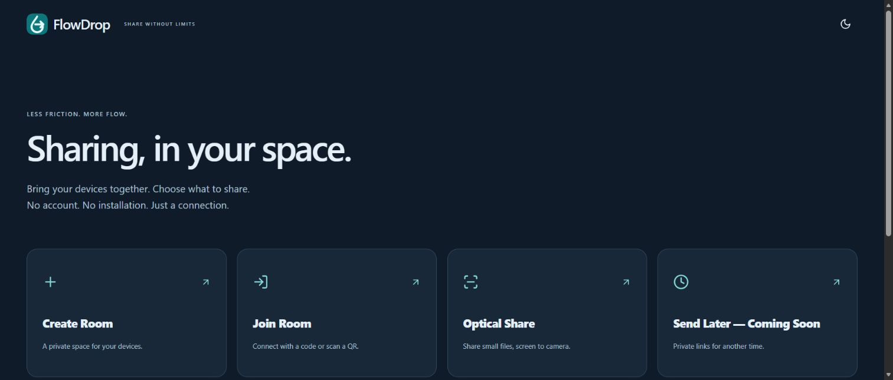
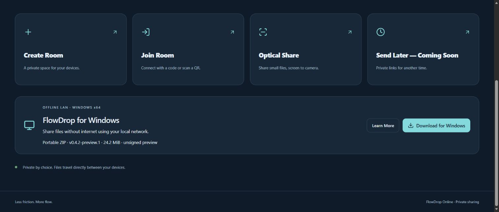
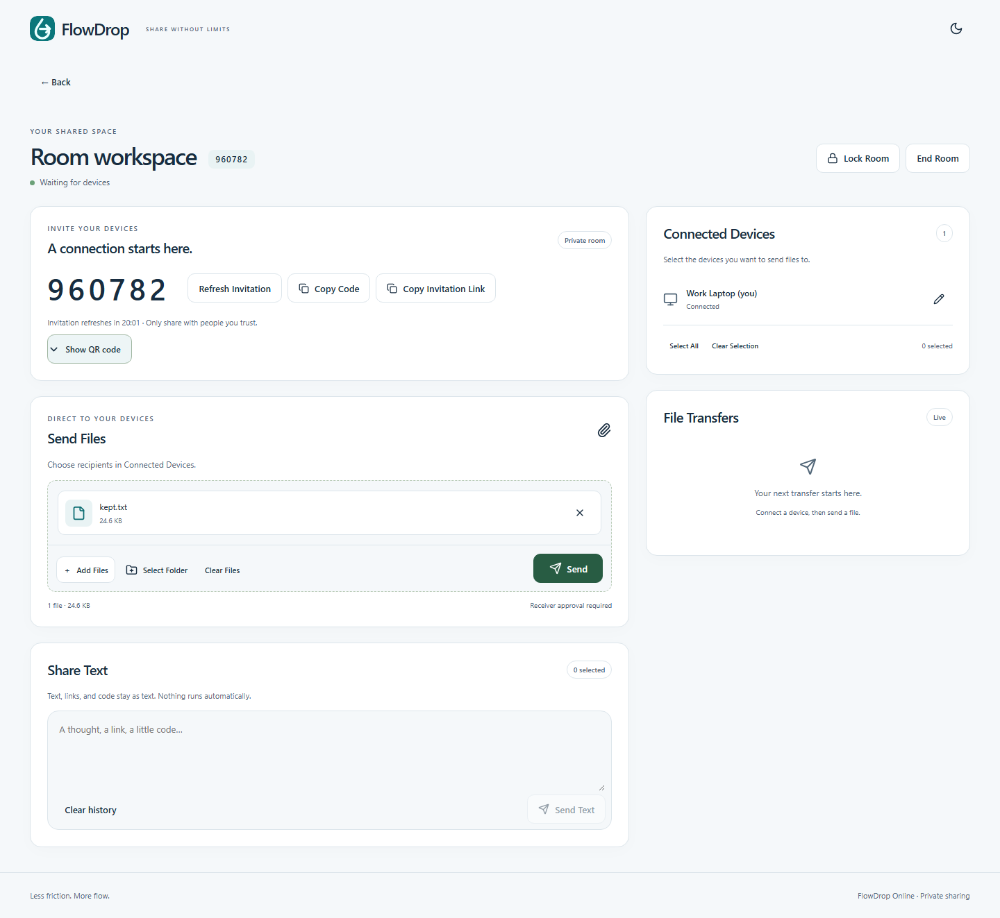
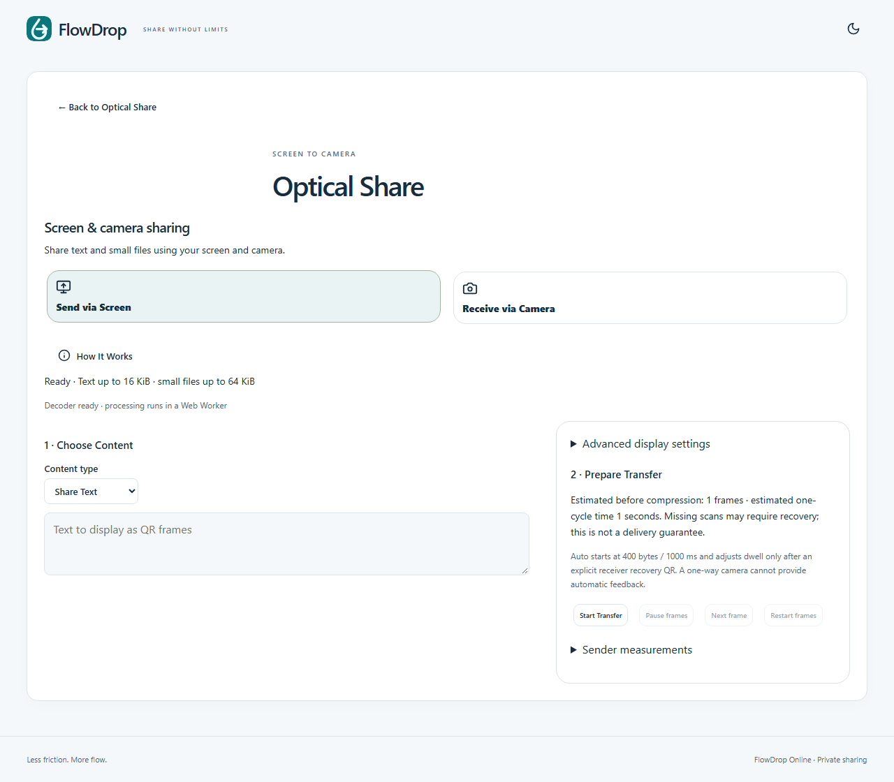
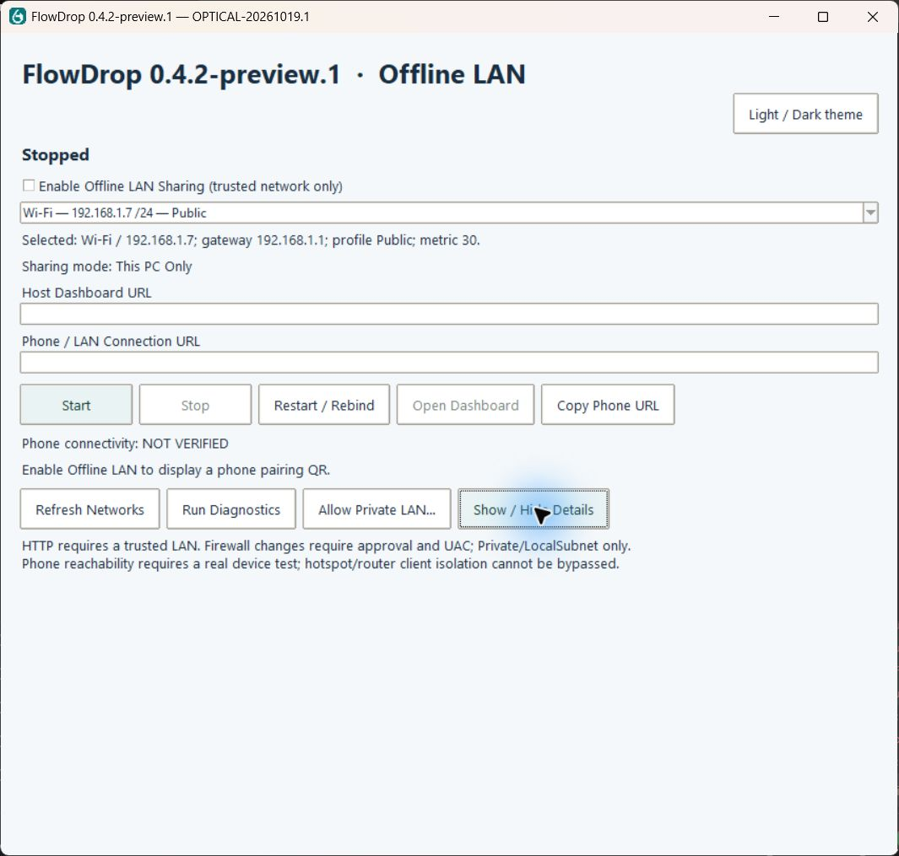

# FlowDrop


File and text sharing between your devices, without an account.

**[Open FlowDrop Online](https://flowdrop-online.pages.dev/)** · [Verification and limitations](docs/OPTICAL_WINDOWS_RELEASE.md) · [LAN setup](docs/OFFLINE_LAN_GUIDE.md)

## Features

- Multi-device rooms with six-digit codes, QR invitations, display names and live renaming.
- Recipient selection, receiver acceptance, multiple files, progress, pause/resume, cancellation and SHA-256 integrity checks.
- Host controls for room locking, invitation refresh, device removal and ending the room.
- Responsive Online workspace with light/dark themes and text chat.
- Windows Offline LAN host with physical adapter selection, pairing, approval and safe loopback-only mode.
- Optical text and small-file transfer with missing-frame recovery and optional parity.
- **Send Later — Coming Soon** in the public and desktop products. Internal development prototypes are not a supported public service.

## Sharing modes

| Mode | Connection | File path | Limits |
| --- | --- | --- | --- |
| Online | Public HTTPS website and signaling service | WebRTC DataChannel between peers | Direct connectivity depends on networks; TURN is not configured |
| Offline LAN | Windows host and browsers on the same accessible LAN/hotspot | Local Windows host | Host must remain running; default LAN HTTP is unencrypted |
| Optical Share | Sender screen and receiver camera | Animated QR frames and offline QR recovery | Text ≤16 KiB, files ≤64 KiB; camera-dependent and slow |

The public site runs independently of your PC. Render Free signaling can sleep and rooms are kept in one instance’s memory; restarts invalidate rooms. Normal Online file bytes do not pass through signaling.

## Get started

### Online

Open [the website](https://flowdrop-online.pages.dev/), create a room, and share the code or invitation QR. Join on another device, select recipients, then send text or offer files. Each receiver must accept a file offer. Different-network PC/phone transfers are not yet physically verified; restrictive NAT may prevent connection without TURN.

### Windows Offline LAN

**[Download Windows x64 portable ZIP](https://github.com/Ashish241/FlowDrop/releases/download/v0.4.2-preview.1/FlowDrop-windows.zip)** · [Release notes](https://github.com/Ashish241/FlowDrop/releases/tag/v0.4.2-preview.1) · [Checksums](https://github.com/Ashish241/FlowDrop/releases/download/v0.4.2-preview.1/WINDOWS_SHA256SUMS.txt)

Version 0.4.2-preview.1 · 24.2 MiB · unsigned preview. The website’s **FlowDrop for Windows** section includes setup and verification details. Extract the entire archive and keep `FlowDrop.exe` beside `_internal`; the EXE is not a standalone installer.

1. Launch FlowDrop. It starts stopped, with LAN sharing disabled.
2. Join the same trusted Wi-Fi, Ethernet network or hotspot on all devices.
3. Enable **Offline LAN Sharing**, confirm the physical adapter, and press **Start**.
4. Open the displayed LAN URL or pairing QR on the other device, then request host approval.
5. Select recipients, offer files and accept them on the receiver.

Mobile-to-mobile LAN sharing still requires the Windows host. Router/client isolation and firewall rules can prevent access. Allow inbound access only on trusted **Private** networks, limited to the local subnet; do not disable the firewall or expose the LAN server publicly. See the [LAN guide](docs/OFFLINE_LAN_GUIDE.md).

### Optical Share

Open Optical Share on both devices while connected, then wait for **Decoder ready**. Choose **Send via Screen** on one device and **Receive via Camera** on the other. Network connectivity is unnecessary after the interfaces and decoder assets load. Camera access requires a supported secure browser context; ordinary HTTP LAN phone pages may not permit camera access.

Start with short text. For files, use conservative 400-byte frames and Normal/Slow playback, keep the complete white QR border visible, and avoid glare. Repeated cycles retain collected frames. If acquisition stalls, choose **Recover Missing Frames**; the sender can scan the receiver’s recovery QR or enter its missing-frame numbers. Download is enabled after reconstruction and SHA-256 verification. Synthetic QR-image tests are not physical-camera verification.

## Screenshots







[Mobile Optical receiver](docs/screenshots/optical-receive-mobile.png) · [Verification report](docs/OPTICAL_WINDOWS_RELEASE.md)

## Technology

React 19, TypeScript, Vite, FastAPI, WebSockets, WebRTC DataChannels, Python/Tkinter, PyInstaller, jsQR and Reed–Solomon erasure coding compiled to WASM. Online hosting uses the existing Cloudflare Pages Free project and Render Free service with manual deployments.

## Local development

```powershell
python -m pip install -e ".[dev,cloud]"
cd apps/web
npm ci
npm run build:desktop
cd ../..
python -m apps.desktop.launcher
```

The native panel stays stopped until Start is pressed. For independent Online development:

```powershell
cd apps/web
npm run build:online
cd ../..
python -m scripts.product_host online
```

The test host binds loopback port 8770 and serves disposable room state. Public Pages builds require the real HTTPS `VITE_SIGNAL_URL`; never put secrets in `VITE_*` variables. See [development](docs/DEVELOPMENT.md), [product boundaries](docs/PRODUCT_SEPARATION.md) and [free hosting](docs/FREE_HOSTING.md).

```powershell
python -m pytest -q
python -m ruff check services apps/desktop scripts tests
cd apps/web
npm run lint
npm test
npm run build:online
npx playwright test --config playwright.rooms.config.ts
npm run build:desktop
npm run test:desktop
cd ../..
powershell -File scripts/build-desktop.ps1
```

Packaging uses the checked-in brand PNG/ICO derived from the existing SVG. To regenerate them locally, run `node render-desktop-brand.mjs` in `apps/web` with Playwright Chromium installed. Builds are repeatable from documented inputs; Windows binaries are not claimed to be byte-for-byte reproducible.

## Security and privacy

No account is required, but invitation codes and room capabilities authorize access: share them only with intended participants. Receiver acceptance is required for file offers. WebRTC encrypts transport; SHA-256 detects corruption and does not authenticate the sender. Signaling handles room membership, peer negotiation and connection metadata. These facts do not establish an audited end-to-end privacy guarantee.

LAN HTTP requires a trusted network. Pairing and host approval protect transfer operations; they do not encrypt that traffic. Optical QR content can be observed by anyone who can see the screen. Packages must not contain service credentials or saved session state.

## Known limitations

- TURN relay is configurable but absent from the public service; restrictive NAT/firewalls may block Online transfers.
- Render Free may sleep; in-memory rooms do not survive service restart or coordinate multiple instances.
- Public server-initiated WebSocket close-frame delivery remains an external Render support issue. Explicit room-ended/removal events are handled; strict transport verification remains separate.
- Optical files near 64 KiB can take minutes and require recovery. Phone-camera performance remains pending physical acceptance.
- Browser download/storage limits vary. Large physical-device transfers and different-network PC/phone acceptance remain unverified.
- Windows preview is unsigned, targets x64, and is tested on this Windows machine; clean-PC acceptance is unverified.
- Seven optional infrastructure tests skip without their external service configuration. Passing local tests is not a production-readiness claim.

## Roadmap and contributing

Send Later remains Coming Soon. Further work includes physical acceptance, TURN availability and durable shared room state within the owner’s hosting constraints. For contributions, preserve product boundaries, add focused regressions, run the relevant checks above and explain actual verification in the pull request. Never commit credentials.

## License

[MIT](LICENSE). The existing license is preserved. Third-party Optical codec attribution ships with the frontend.
