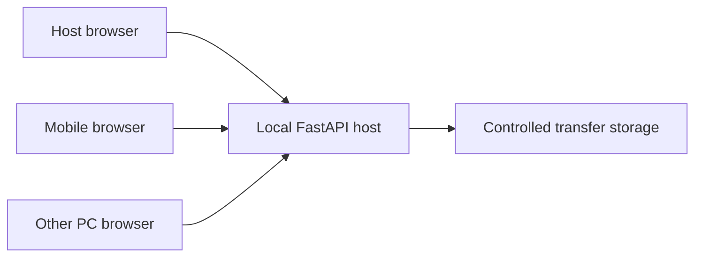
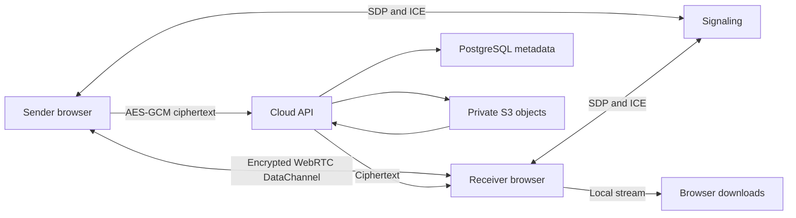

# Architecture

The local React application is served by FastAPI. Browser clients authenticate with short-lived bearer capabilities. Host approval and recipient acceptance are separate decisions. The server stores chunks under random transfer identifiers, verifies the final SHA-256, and only permits the recipient to download. File names never determine storage paths.

Online signaling and cloud storage are independent services and are not imported by the portable LAN runtime. WebRTC carries ordinary online file bytes directly; signaling only exchanges room/SDP/ICE messages. Send Later encrypts browser-side before storage. A shared streaming sink handles WebRTC reception and decrypted cloud chunks without routing P2P contents through the server.

Current API schemas are discoverable at `/openapi.json`. Authentication capabilities are never placed in API query strings. The host launcher provides its initial capability in a URL fragment, which the UI removes and stores in tab session storage.
