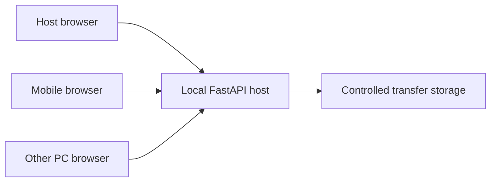
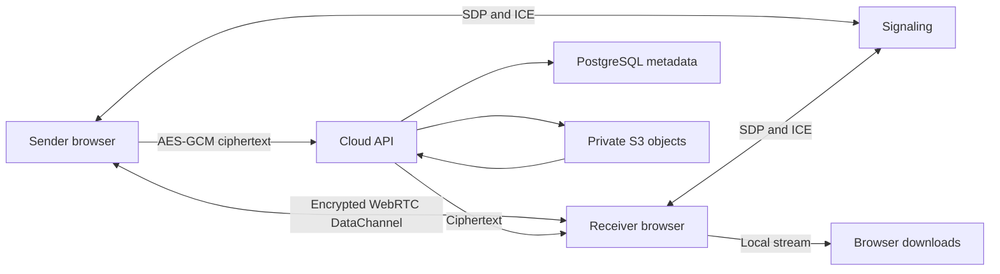

# Integrated 0.4.0 — INTEGRATED-20261016.1

Current source starts at `b1a3ec2`; the earlier split and working LAN checkpoints are preserved. Desktop and Web now both expose Optical Share and Send Later — Coming Soon. Online adds six-digit temporary codes (10-minute TTL), existing strong room IDs/capabilities and owner approval, cooperative in-session pause/resume, safe text copy/clear/history controls, transfer metadata and measured speed/ETA. Progress stays below 100% until integrity verification. Interrupted WebRTC files still require whole-file resend; in-flight chunks may settle after pause. Resume on the device that paused.

Optical version-1 text remains compatible and version-2 supports files up to 64 KiB. The same QR decoder accepts camera frames or imported images and supports repeated, missing, duplicate and out-of-order frames. Existing offline LAN routing, pairing, resume and firewall/adapter logic are unchanged. See [Optical guide](OPTICAL_SHARING_GUIDE.md) and [current verification](INTEGRATED_VERIFICATION.md).

Send Later is a visible non-upload Coming Soon screen in shipping builds. No cloud API is called by that screen, no new database/storage/payment dependency is added, and the public Nginx `/cloud/` route returns 404. Legacy implementation and its explicitly local combined regression host are retained; it is not part of the shipping website/desktop feature set. No cloud service was deployed.

Public deployment and Internet/TURN/physical-device verification remain open. No push, publication, public deployment or expenses were authorized or performed.

---

# Architecture

The local React application is served by FastAPI. Browser clients authenticate with short-lived bearer capabilities. Host approval and recipient acceptance are separate decisions. The server stores chunks under random transfer identifiers, verifies the final SHA-256, and only permits the recipient to download. File names never determine storage paths.

Online signaling and cloud storage are independent services and are not imported by the portable LAN runtime. WebRTC carries ordinary online file bytes directly; signaling only exchanges room/SDP/ICE messages. Send Later encrypts browser-side before storage. A shared streaming sink handles WebRTC reception and decrypted cloud chunks without routing P2P contents through the server.

Current API schemas are discoverable at `/openapi.json`. Authentication capabilities are never placed in API query strings. The host launcher provides its initial capability in a URL fragment, which the UI removes and stores in tab session storage.

In Redis mode, signaling instances share room state through optimistic transactions and route SDP/ICE over Pub/Sub. Connection generations invalidate replaced sockets; TTLs and owner revocation invalidate capabilities across instances. Cloud rate counters use Redis when configured and fail closed on outage. Memory mode remains for single-instance development. PostgreSQL serializes quota reservation and download-session issuance; file contents remain private S3 ciphertext.

Browser queues use capability-scoped IndexedDB source Files, verified against source hashes after recovery. LAN chunk admission is round-robin with two active transfers and one request per transfer. Interrupted WebRTC files restart after renegotiation/approval; encrypted links resume server-confirmed chunk indexes. Browser save handoff and explicit receiver confirmation are separate states.
